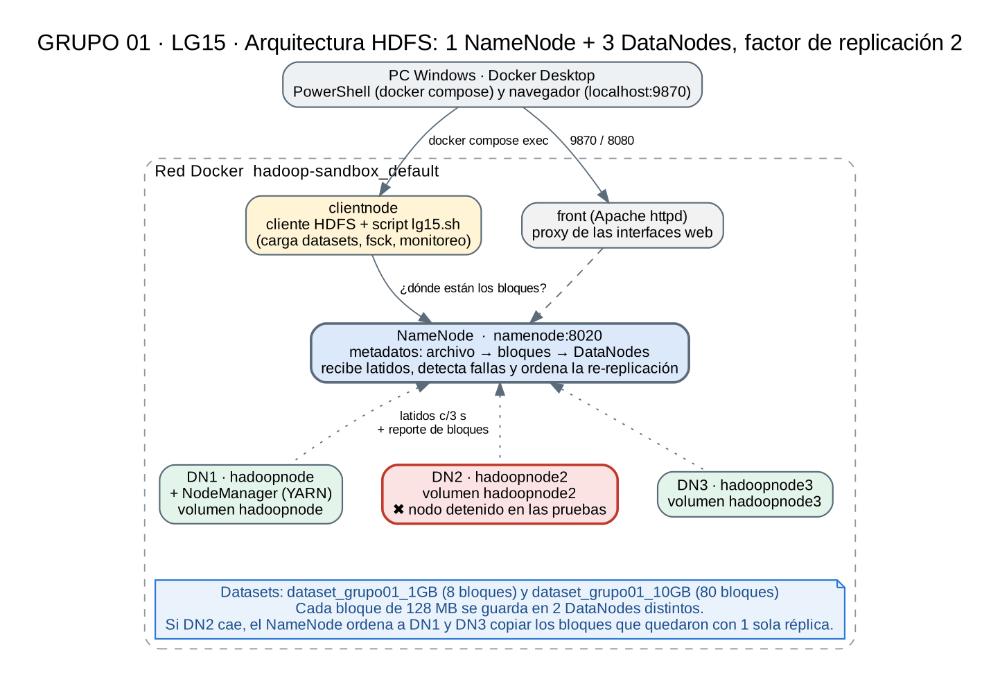
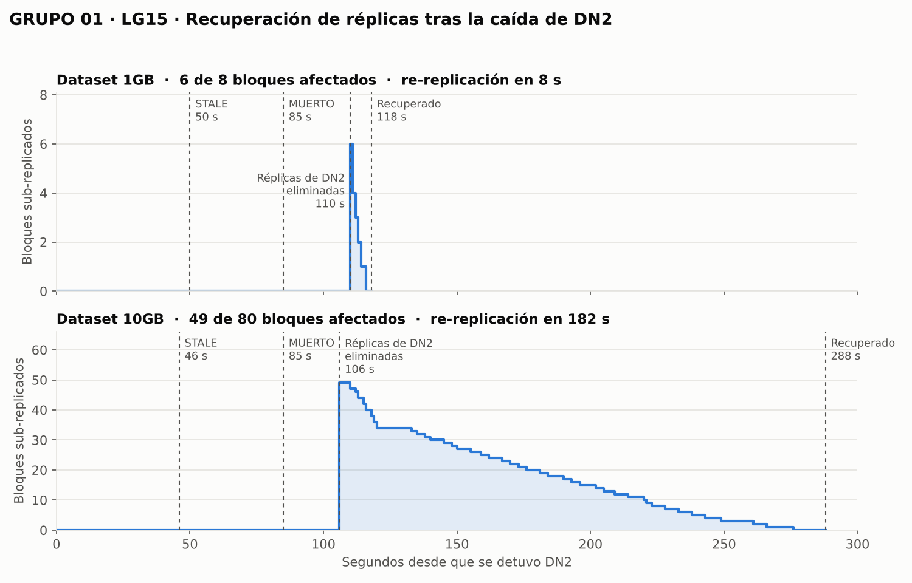

# sandbox-01 · LG15 – Tolerancia a fallos y replicación de datos en HDFS

**Universidad del Valle** · Tecnologías Emergentes I · **GRUPO 01**

| Integrantes |
|---|
| Edson Marcelo Cayo Ali |
| Joel Julio Salazar Ferrufino |
| Alex Bryam Barrera Alarcon |

---

## 1. Descripción

Implementamos un clúster **Hadoop HDFS con 1 NameNode y 3 DataNodes**, con **factor de replicación 2**, sobre Docker. Cargamos dos datasets (**1 GB** y **10 GB**) y con cada uno hicimos una **prueba de fallo**: detuvimos un DataNode (DN2) y registramos, con evidencias, el estado de los bloques y réplicas **antes, durante y después** de la caída.

El entorno se basa en el repositorio [hadoop-sandbox/hadoop-sandbox](https://github.com/hadoop-sandbox/hadoop-sandbox) (Hadoop 3.5.0), que trae un solo DataNode. Lo ampliamos con:

- `config/docker-compose.override.yml`: agrega **DN2** y **DN3**, cada uno con su propio volumen.
- `config/hdfs-site.xml`: replicación **2** y detección más rápida de nodos caídos.
- `scripts/lg15.sh`: registra el estado del clúster, monitorea la falla segundo a segundo y compara la ubicación de los bloques antes y después.

## 2. Requerimientos de la práctica

| Componente | Requerido | Implementado |
|---|---|---|
| NameNode | 1 | 1 (`namenode`) |
| DataNodes | 3 | 3: DN1 `hadoopnode`, DN2 `hadoopnode2`, DN3 `hadoopnode3` |
| Factor de replicación | ≥ 2 | **2** (`dfs.replication`) |
| Dataset 1 | 1 GB | `/grupo01/dataset_1GB/dataset_grupo01_1GB` (1 073 741 824 B) |
| Dataset 2 | 10 GB | `/grupo01/dataset_10GB/dataset_grupo01_10GB` (10 737 418 240 B) |
| Pruebas de fallo | 2 | Caída de DN2 con el dataset de 1 GB y con el de 10 GB |
| Evidencias | Obligatorio | [`evidencias/`](evidencias/) (capturas) y [`resultados/`](resultados/) (salidas completas) |
| Identificación del grupo | `/grupoXX/` | `/grupo01/` con `dataset_1GB`, `dataset_10GB`, `resultados`, `evidencias`; cada registro de los datasets empieza con `grupo01` |

## 3. Arquitectura



| Nodo | Servicio Docker | Hostname | Función |
|---|---|---|---|
| NameNode | `namenode` | namenode | Guarda los metadatos (qué bloques forman cada archivo y en qué DataNodes está cada réplica), recibe los latidos y ordena la re-replicación |
| DN1 | `datanode` | hadoopnode | Guarda bloques. Comparte red con el NodeManager de YARN |
| DN2 | `datanode2` | hadoopnode2 | Guarda bloques. **Es el nodo que detenemos en las pruebas** |
| DN3 | `datanode3` | hadoopnode3 | Guarda bloques |
| Cliente | `clientnode` | clientnode | Desde aquí se cargan los datasets y se ejecutan los scripts |
| Proxy web | `front` | front | Publica las interfaces web en `localhost` (9870, 8088, 8080…) |

**Configuración de HDFS utilizada** (`config/hdfs-site.xml`):

| Propiedad | Valor | Efecto |
|---|---|---|
| `dfs.replication` | 2 | Cada bloque se guarda en 2 DataNodes distintos |
| `dfs.namenode.heartbeat.recheck-interval` | 30 000 ms | Un DataNode se declara muerto a los 2 × 30 s + 10 × 3 s = **90 s** sin latidos. Con el valor por defecto (5 min) serían 10 min 30 s; lo bajamos para que las pruebas fueran prácticas |
| Tamaño de bloque | 128 MB (por defecto) | 1 GB → 8 bloques; 10 GB → 80 bloques |

## 4. Instalación

Requisitos: Docker Desktop (Compose 2.x) y unos **25 GB libres** (11 GB de datos × 2 réplicas).

```powershell
# 1. Clonar el repositorio base (con saltos de línea Linux)
git clone --config core.autocrlf=false https://github.com/hadoop-sandbox/hadoop-sandbox.git
cd hadoop-sandbox

# 2. Agregar nuestra configuración
Copy-Item conf\hadoop\hdfs-site.xml conf\hadoop\hdfs-site.xml.bak
Copy-Item <este-repo>\config\docker-compose.override.yml .
Copy-Item <este-repo>\config\hdfs-site.xml conf\hadoop\hdfs-site.xml -Force

# 3. Levantar el clúster (15 contenedores)
docker compose up -d
docker compose ps

# 4. Verificar: 3 DataNodes vivos y replicación 2
docker compose exec -u hdfs clientnode hdfs dfsadmin -report
docker compose exec -u hdfs clientnode hdfs getconf -confKey dfs.replication
```

## 5. Ejecución

```powershell
# Copiar los scripts al nodo cliente
docker compose cp <este-repo>\scripts clientnode:/tmp/lg15
docker compose exec clientnode bash -c "sed -i 's/\r$//' /tmp/lg15/*.sh"

# Estructura del grupo en HDFS y datasets
docker compose exec -u hdfs    clientnode bash /tmp/lg15/preparar_hdfs.sh
docker compose exec -u sandbox clientnode bash /tmp/lg15/generar_datasets.sh 1GB
docker compose exec -u sandbox clientnode bash /tmp/lg15/generar_datasets.sh 10GB
```

**Prueba de fallo** (se repite con `1GB` y con `10GB`):

```powershell
# a) Estado inicial
docker compose exec -u hdfs clientnode bash /tmp/lg15/lg15.sh estado 1GB antes

# b) Falla de DN2 + monitoreo (al terminar muestra el estado DESPUÉS y la comparación)
docker compose stop datanode2; docker compose exec -u hdfs clientnode bash /tmp/lg15/lg15.sh monitor 1GB

# c) Restaurar DN2 y registrar el estado final (esperar 2-3 min)
docker compose start datanode2
docker compose exec -u hdfs clientnode bash /tmp/lg15/lg15.sh estado 1GB restaurado

# d) Guardar los resultados en HDFS (/grupo01/resultados) y copiarlos a la PC
docker compose exec -u hdfs clientnode bash /tmp/lg15/lg15.sh guardar
docker compose cp clientnode:/tmp/lg15_out resultados
```

| Comando de `lg15.sh` | Qué registra |
|---|---|
| `estado <ds> <momento>` | Estado de los DataNodes, estado del archivo (`fsck`), réplicas por DataNode, ubicación de cada bloque, checksum y prueba de lectura completa |
| `monitor <ds>` | Cada 1 s: nodos vivos/stale/muertos, bloques que el NameNode ubica en DN2, bloques sub-replicados y copias pendientes. Mide los tiempos de cada fase |
| `comparar <ds>` | Para cada bloque: réplicas antes, réplicas después, réplica perdida y **DataNode donde se creó la nueva** |
| `guardar` | Copia todos los resultados a `/grupo01/resultados` en HDFS |

## 6. Resultados

### 6.1 Evolución de la falla



| Fase (segundos desde que se detuvo DN2) | Dataset 1 GB | Dataset 10 GB |
|---|---|---|
| DN2 pasa a **STALE** (sin latidos > 30 s) | 50 s | 46 s |
| El NameNode marca a DN2 como **MUERTO** | 85 s | 85 s |
| El NameNode **elimina las réplicas de DN2** de su mapa → bloques sub-replicados | 110 s | 106 s |
| **Re-replicación completa** (todos los bloques otra vez con 2 réplicas) | 118 s | 288 s |
| Duración de la re-replicación | **8 s** | **182 s** |

### 6.2 Prueba 1 – Dataset 1 GB (8 bloques)

**Antes** (`resultados/1GB/antes/`): 8 bloques, 2 réplicas cada uno, estado HEALTHY.

| DataNode | Réplicas | Bloques |
|---|---|---|
| DN1 | 3 | 2, 5, 7 |
| **DN2** | **6** | **0, 1, 3, 4, 6, 7** |
| DN3 | 7 | 0, 1, 2, 3, 4, 5, 6 |

**Durante** (`resultados/1GB/durante/`, `resultados/1GB/monitor/`):
- DN2 detenido. Los bloques 0, 1, 3, 4, 6 y 7 quedaron con **1 réplica viva** (0, 1, 3, 4 y 6 en DN3; 7 en DN1).
- `fsck`: *Under-replicated blocks: 6 (75 %)*. Para cada bloque: *"Target Replicas is 2 but found 1 live replica(s)"*.
- El archivo **se leyó completo** (1 073 741 824 bytes) con DN2 caído. El cliente registró `Failed to connect to /172.22.0.4:9866 ... Add to deadNodes and continue with other datanodes` y enseguida `Successfully connected to /172.22.0.5:9866`: pasó a la otra réplica.

**Después** (`resultados/1GB/despues/`, `resultados/1GB/comparacion.txt`): estado HEALTHY, replicación promedio 2.0, 0 sub-replicados. Se crearon **6 réplicas nuevas: 5 en DN1 y 1 en DN3**. Checksum idéntico al inicial: `…73f8910e99b1d86bd029de245ccbb489`.

**Restaurado** (`resultados/1GB/restaurado/`): DN2 volvió con sus 6 réplicas antiguas. Esos bloques quedaron con 3 copias y el NameNode **borró las sobrantes**: todo volvió a replicación 2 con 0 sobre-replicados.

### 6.3 Prueba 2 – Dataset 10 GB (80 bloques)

**Antes** (`resultados/10GB/antes/`): 80 bloques, 2 réplicas cada uno, HEALTHY. DN1 tenía 53 réplicas, **DN2 49** y DN3 58.

**Durante**: DN2 detenido. **49 bloques** quedaron con 1 réplica viva (*Under-replicated blocks: 49 (61.25 %)*). El archivo de 10 GB **se leyó completo** con DN2 caído, con el mismo cambio automático de réplica. La re-replicación fue **gradual**: los sub-replicados bajaron de 49 a 0 en 182 s, con un máximo de 12 copias en curso al mismo tiempo.

**Después**: HEALTHY, replicación 2.0, 0 sub-replicados. Se crearon **49 réplicas nuevas: 27 en DN1 y 22 en DN3**. Checksum idéntico al inicial: `…f034903a8b6737ee965eda118a89658a`.

**Restaurado**: DN2 volvió con sus 49 réplicas antiguas y el NameNode eliminó las sobrantes (DN1 quedó con 31, DN2 con 49 y DN3 con 80; 160 réplicas = 80 bloques × 2).

### 6.4 Tiempo de lectura completa del archivo

| Momento | 1 GB | 10 GB |
|---|---|---|
| Antes de la falla | 5 s | 93 s |
| **Con DN2 caído** | **44 s** | **105 s** |
| Después de la recuperación | 6 s | 82 s |

Durante la falla el archivo siguió disponible, pero la lectura fue más lenta. El cliente intentó conectarse primero a DN2 y esperó hasta recibir `No route to host`; recién entonces lo marcó como nodo muerto y siguió con la otra réplica.

## 7. Análisis

### 7.1 ¿Por qué ocurrió así? El mecanismo de replicación de HDFS

1. **Latidos (heartbeats).** Cada DataNode avisa al NameNode cada 3 s que está vivo y le envía periódicamente un reporte de los bloques que guarda.
2. **STALE.** Si pasan más de 30 s sin latidos, el NameNode considera al nodo *stale* (sospechoso). Todavía no hace nada con sus bloques.
3. **MUERTO.** A los 90 s sin latidos (2 × `recheck-interval` + 10 × latido) el nodo se cuenta como muerto. En las pruebas apareció a los 85 s porque el reloj del monitor empezó cuando el contenedor ya había terminado de detenerse.
4. **Eliminación de sus réplicas.** En la siguiente revisión periódica (cada 30 s) el NameNode quita al nodo de su mapa de bloques. Recién ahí los bloques que tenían una réplica en DN2 pasan a estar **sub-replicados** (106–110 s).
5. **Re-replicación.** El NameNode elige, para cada bloque sub-replicado, un DataNode **origen** que tiene la réplica sobreviviente y un DataNode **destino** que no la tiene, y le ordena copiarla. Limita cuántas copias asigna a la vez a cada DataNode para no saturar la red ni los discos. Por eso con 10 GB la recuperación fue gradual.
6. **Destino forzado.** Con 3 DataNodes y uno caído, cada bloque tiene su copia sobreviviente en uno de los 2 nodos vivos, así que la nueva réplica **solo puede ir al otro**. En el dataset de 1 GB, 5 de los 6 bloques afectados tenían su copia en DN3, por eso 5 réplicas nuevas fueron a DN1.
7. **Retorno del nodo.** Cuando DN2 vuelve, reporta sus réplicas antiguas (sus datos seguían en su volumen). Esos bloques quedan con 3 copias (*sobre-replicados*) y el NameNode borra una para volver al factor configurado.

### 7.2 Respuestas – Dataset 1 GB

| | Pregunta | Respuesta |
|---|---|---|
| **Antes** | ¿Cuántos bloques tenía el archivo? | 8 bloques de 128 MB |
| | ¿Cuántas réplicas tenía cada bloque? | 2 |
| | ¿En qué DataNodes estaban? | DN1: 2, 5, 7 · DN2: 0, 1, 3, 4, 6, 7 · DN3: 0–6 |
| **Durante** | ¿Qué DataNode fue detenido? | DN2 (hadoopnode2, 172.22.0.4) |
| | ¿Qué bloques estaban almacenados en él? | 0, 1, 3, 4, 6 y 7 (6 de 8) |
| | ¿Existían otras réplicas? | Sí: 0, 1, 3, 4 y 6 en DN3; 7 en DN1 |
| | ¿El archivo continuó disponible? | Sí, se leyó completo (1 GB) en 44 s |
| | ¿Qué cambió en HDFS? | DN2 pasó a STALE (50 s) y a MUERTO (85 s); 6 bloques quedaron sub-replicados (110 s) |
| **Después** | ¿Qué estado reporta HDFS? | HEALTHY, replicación promedio 2.0 |
| | ¿Existen bloques sub-replicados? | Hubo 6 durante 8 s; al final, 0 |
| | ¿HDFS recuperó automáticamente las réplicas? | Sí, sin intervención, en 8 s |
| | ¿En qué DataNode se generaron las nuevas réplicas? | 5 en DN1 (bloques 0, 1, 3, 4, 6) y 1 en DN3 (bloque 7) |

### 7.3 Respuestas – Dataset 10 GB

| | Pregunta | Respuesta |
|---|---|---|
| **Antes** | ¿Cuántos bloques tenía el archivo? | 80 bloques de 128 MB |
| | ¿Cuántas réplicas tenía cada bloque? | 2 |
| | ¿En qué DataNodes estaban? | DN1: 53 réplicas · DN2: 49 · DN3: 58 (lista en `resultados/10GB/antes/bloques.txt`) |
| **Durante** | ¿Qué DataNode fue detenido? | DN2 (hadoopnode2, 172.22.0.4) |
| | ¿Qué bloques estaban almacenados en él? | 49 de 80 (lista en `resultados/10GB/comparacion.txt`) |
| | ¿Existían otras réplicas? | Sí, cada uno tenía su otra réplica en DN1 o en DN3 |
| | ¿El archivo continuó disponible? | Sí, se leyó completo (10 GB) en 105 s |
| | ¿Qué cambió en HDFS? | DN2 pasó a STALE (46 s) y a MUERTO (85 s); 49 bloques quedaron sub-replicados (106 s) |
| **Después** | ¿Qué estado reporta HDFS? | HEALTHY, replicación promedio 2.0 |
| | ¿Existen bloques sub-replicados? | Hubo 49, que bajaron gradualmente a 0 en 182 s |
| | ¿HDFS recuperó automáticamente las réplicas? | Sí, sin intervención |
| | ¿En qué DataNode se generaron las nuevas réplicas? | 27 en DN1 y 22 en DN3 |

## 8. Comparación entre ambos experimentos

| Característica | Dataset 1 GB | Dataset 10 GB |
|---|---|---|
| Tamaño | 1 GB (1 073 741 824 B) | 10 GB (10 737 418 240 B) |
| Número de bloques | 8 | 80 |
| Factor de replicación | 2 | 2 |
| DataNode afectado | DN2 (hadoopnode2) | DN2 (hadoopnode2) |
| Bloques afectados | 6 de 8 (75 %) | 49 de 80 (61 %) |
| Bloques disponibles después de la falla | 8 de 8 (los 6 afectados con 1 réplica) | 80 de 80 (los 49 afectados con 1 réplica) |
| ¿Archivo accesible? | Sí (lectura completa en 44 s con DN2 caído) | Sí (lectura completa en 105 s con DN2 caído) |
| ¿Existieron bloques sub-replicados? | Sí, 6 | Sí, 49 |
| Tiempo de recuperación | 118 s (110 s de detección + 8 s de re-replicación) | 288 s (106 s de detección + 182 s de re-replicación) |
| Nuevas réplicas | 6: 5 en DN1, 1 en DN3 | 49: 27 en DN1, 22 en DN3 |

**Conclusión de la comparación:** el tiempo de **detección** fue prácticamente el mismo en ambos casos (~110 s), porque depende de la configuración de latidos y no del tamaño de los datos. El tiempo de **re-replicación** sí creció con el tamaño (8 s contra 182 s), porque hay que copiar más bloques y HDFS limita las copias simultáneas.

## 9. Preguntas de la exposición

**1. ¿Por qué HDFS puede continuar proporcionando el archivo aunque un DataNode haya fallado?**
Porque cada bloque tiene una segunda réplica en otro DataNode. El NameNode le entrega al cliente todas las ubicaciones de cada bloque; si una falla, el cliente pasa a la siguiente. Lo vimos en el registro del cliente: `Failed to connect to /172.22.0.4:9866 … Add to deadNodes and continue with other datanodes` y luego `Successfully connected to /172.22.0.5:9866`.

**2. ¿Qué habría ocurrido si el factor de replicación hubiera sido 1?**
Cada bloque existiría en un solo DataNode. Al caer DN2, sus bloques (6 de 8 en el dataset de 1 GB, 49 de 80 en el de 10 GB) no tendrían otra copia: `fsck` los reportaría como *missing*, el estado sería CORRUPT y el archivo no se podría leer completo. HDFS tampoco podría re-replicarlos, porque no hay copia origen. Solo se recuperarían si DN2 volviera con su disco intacto; si el disco se perdiera, los datos se perderían para siempre.

**3. ¿Qué habría ocurrido si hubieran fallado dos DataNodes simultáneamente?**
Con replicación 2, se perderían los bloques que tenían **sus dos réplicas justo en esos dos nodos**. Con la distribución que medimos antes de la falla:

| Nodos caídos | Bloques perdidos (1 GB) | Bloques perdidos (10 GB) |
|---|---|---|
| DN2 + DN3 | 5 de 8 | 27 de 80 |
| DN1 + DN2 | 1 de 8 | 22 de 80 |
| DN1 + DN3 | 2 de 8 | 31 de 80 |

El archivo no se podría leer completo, y los bloques sobrevivientes quedarían sub-replicados sin poder recuperarse, porque solo quedaría 1 nodo vivo. Si las fallas ocurren **una después de otra**, con tiempo suficiente para que termine la re-replicación (118 s o 288 s en nuestras pruebas), no se pierde nada.

**4. ¿Por qué un factor de replicación de 2 no significa necesariamente que existan dos copias completas del archivo en dos DataNodes?**
Porque HDFS replica **bloques**, no archivos. Cada bloque elige sus 2 DataNodes por separado, así que las réplicas quedan repartidas entre los 3 nodos y ninguno tiene necesariamente el archivo entero. En el dataset de 10 GB, antes de la falla, DN1 tenía 53 de los 80 bloques, DN2 49 y DN3 58: ninguno tenía una copia completa.

**5. ¿Cuál es la relación entre tamaño de bloque y número de bloques?**
Número de bloques = tamaño del archivo ÷ tamaño de bloque, redondeado hacia arriba. Con bloques de 128 MB: 1 GB → 8 bloques y 10 GB → 80 bloques. Bloques más grandes significan menos bloques y menos metadatos en el NameNode, pero menos paralelismo. Bloques más pequeños dan más paralelismo, pero recargan la memoria del NameNode.

**6. ¿Por qué el dataset de 10 GB permite observar un comportamiento más representativo de un sistema distribuido?**
Con 8 bloques la muestra es muy pequeña: la recuperación terminó en 8 s y las réplicas nuevas quedaron desbalanceadas (5 en DN1 y 1 en DN3). Con 80 bloques se ve un reparto parejo entre los 3 nodos (53/49/58), re-replicación hacia los dos nodos vivos (27/22) y el **control de carga** de HDFS: la recuperación avanzó de forma gradual durante 182 s, con un máximo de 12 copias simultáneas, en vez de copiarlo todo de golpe.

**7. ¿Qué sucede con los bloques que tenían una réplica en el DataNode que falló?**
Al principio nada: el NameNode tarda en notar la caída (STALE a los ~46–50 s, MUERTO a los 85 s). Cuando quita al nodo de su mapa (106–110 s), esos bloques quedan con 1 réplica viva y entran en la cola de **sub-replicados** (*"Target Replicas is 2 but found 1 live replica"*). El NameNode ordena copiarlos desde el nodo que conserva la réplica hacia el otro nodo vivo, hasta volver a 2. Si DN2 regresa, sus réplicas antiguas quedan como **sobrantes** y se eliminan.

**8. ¿Quién administra la ubicación y replicación de los bloques: el cliente, el DataNode o el NameNode?**
El **NameNode**. Mantiene el mapa de bloques, decide dónde se guarda cada réplica, detecta los nodos caídos, ordena la re-replicación y elimina las réplicas sobrantes. Los **DataNodes** solo almacenan los bloques, envían latidos y reportes y ejecutan las copias que se les ordenan. El **cliente** pregunta al NameNode dónde están los bloques y lee o escribe directamente en los DataNodes; puede cambiar de réplica si una falla, pero no decide la replicación.

**9. ¿Qué diferencia existe entre disponibilidad del archivo y cumplimiento del factor de replicación después de una falla?**
**Disponibilidad** es poder leer el archivo: basta con que cada bloque tenga al menos 1 réplica viva, y se cumplió durante toda la prueba. **Cumplimiento del factor de replicación** es que cada bloque tenga las 2 réplicas configuradas, y **no** se cumplió entre los segundos 106–110 y 118–288. En esa ventana el archivo estaba disponible pero **en riesgo**: una segunda falla habría perdido bloques. Por eso `fsck` mostraba **HEALTHY** (no faltaba ningún bloque) y al mismo tiempo 6 o 49 bloques sub-replicados.

## 10. Estructura del repositorio

```
sandbox-01/
├── README.md
├── config/
│   ├── docker-compose.override.yml   # agrega DN2 y DN3
│   └── hdfs-site.xml                 # replicación 2 y detección en ~90 s
├── scripts/
│   ├── preparar_hdfs.sh              # crea /grupo01/...
│   ├── generar_datasets.sh           # datasets de 1 GB y 10 GB
│   ├── lg15.sh                       # estado, monitoreo, comparación y guardado
│   └── graficar_recuperacion.py      # genera diagrama/recuperacion_replicas.png
├── diagrama/
│   ├── arquitectura.png / .dot
│   └── recuperacion_replicas.png
├── resultados/                       # salidas completas de cada prueba
│   ├── 1GB/  {antes, durante, despues, restaurado, monitor, comparacion.txt}
│   └── 10GB/ {antes, durante, despues, restaurado, monitor, comparacion.txt}
└── evidencias/                       # capturas de pantalla
```

## 11. Notas

- Los datasets se generaron con un script para controlar el tamaño exacto e identificar al grupo en cada registro (`grupo01,0000000001,LG15,…`). HDFS divide y replica cualquier archivo de la misma forma, sin importar su contenido.
- Los tres DataNodes corren en la misma PC y comparten su disco físico. En un clúster real cada DataNode estaría en otra máquina, y la re-replicación dependería también de la red.
- Las horas de las salidas están en hora de Bolivia (UTC−4). Los registros internos de Hadoop usan UTC.
- El repositorio base hadoop-sandbox no se incluye aquí; se clona desde su repositorio original (ver Instalación).

---

Práctica LG15 · Tecnologías Emergentes I · GRUPO 01 · Universidad del Valle · Cochabamba, 2026
